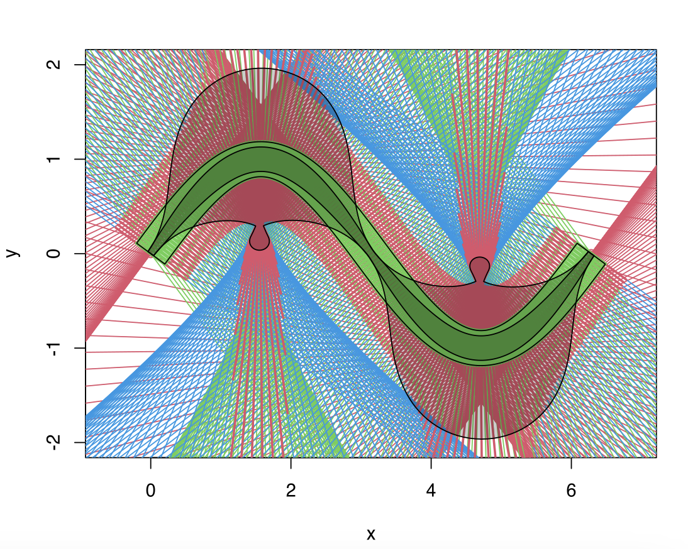
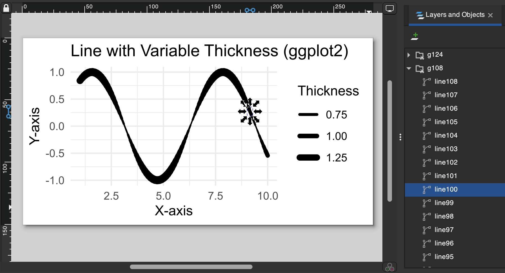
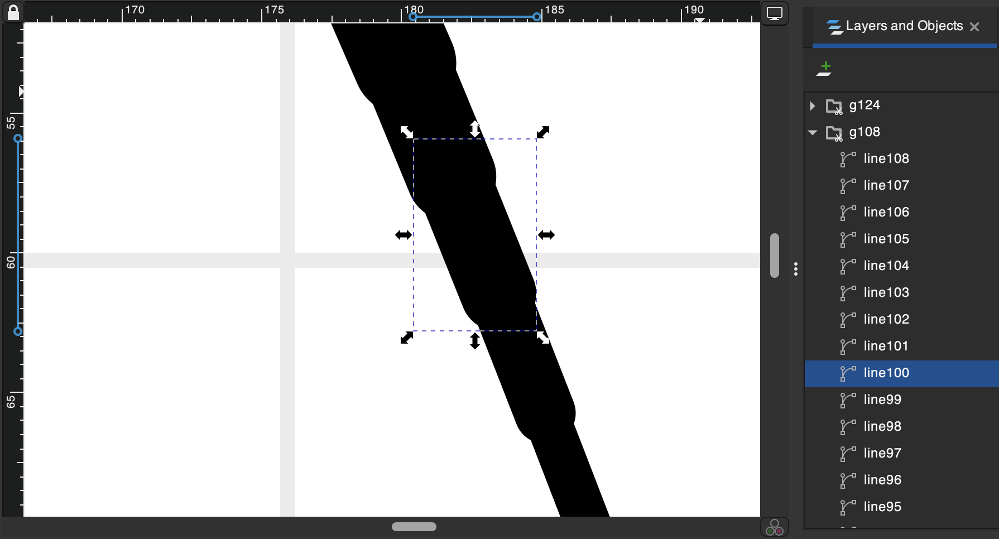
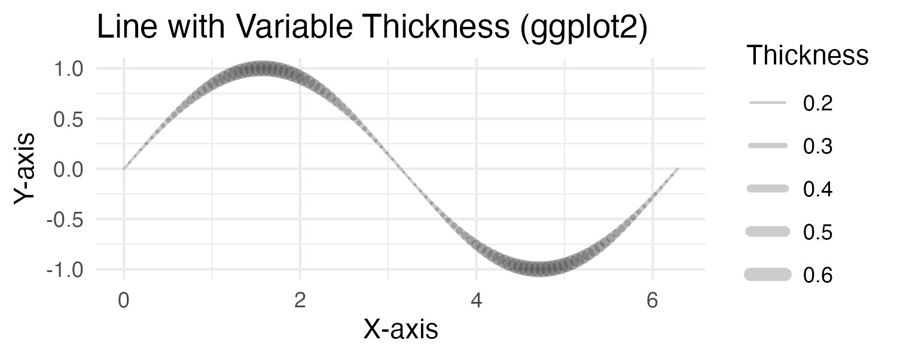
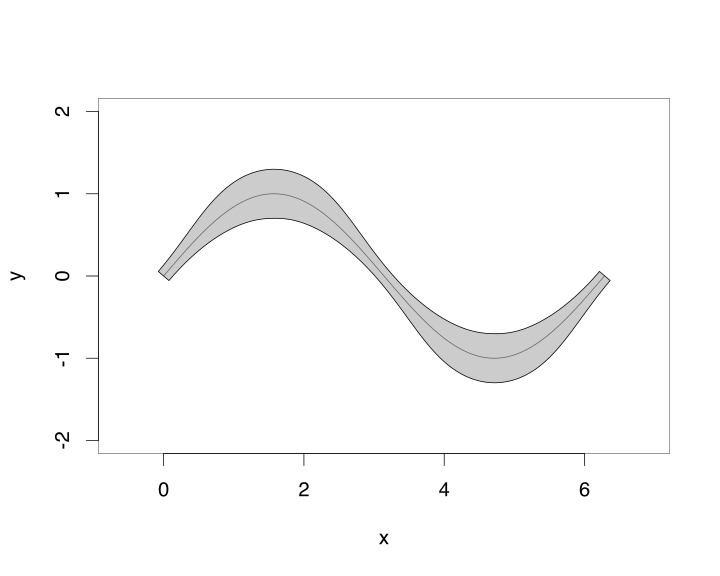
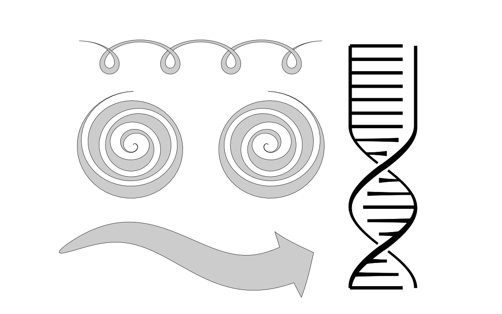
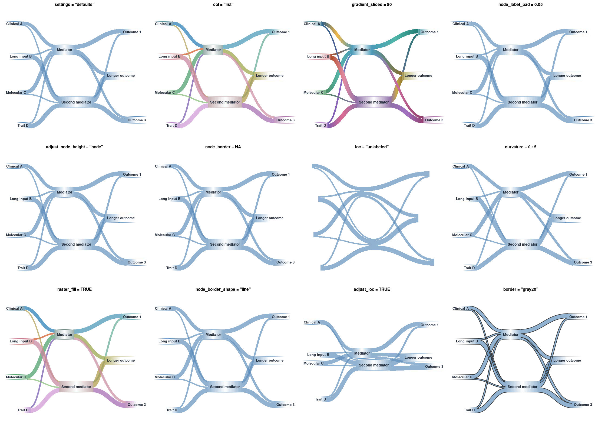
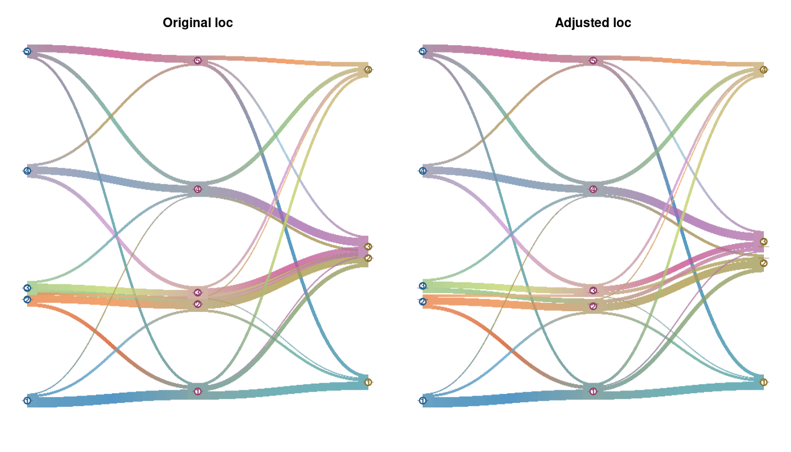
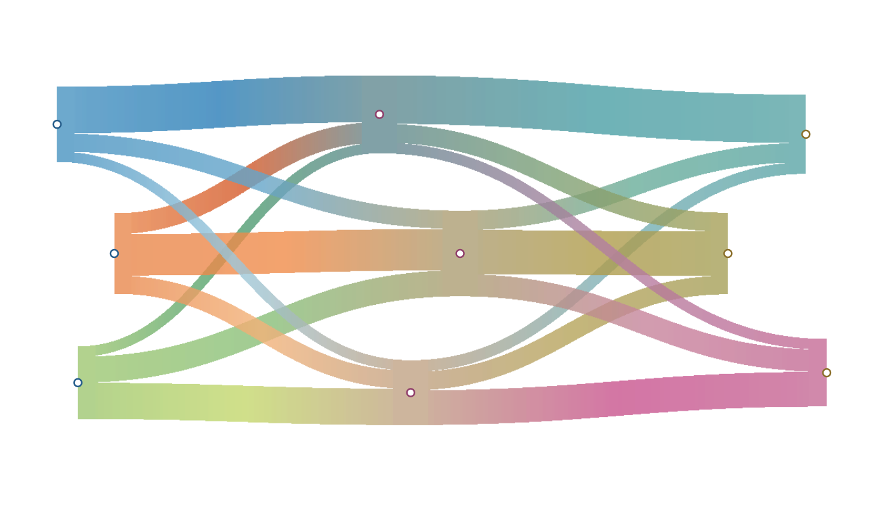
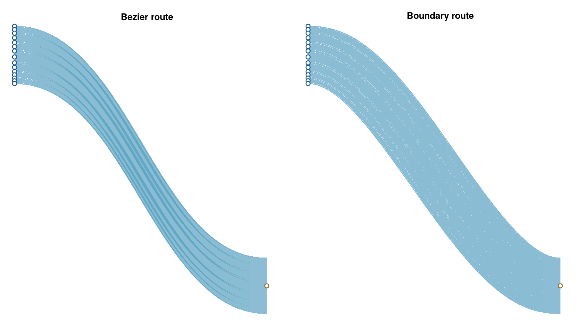

# Polylines

## Introduction

Base R doesn't have a function to draw `lines()` or `segments()` with variable line width, and instead only accepts scalar input for their `lwd =` argument. I thought one would be useful and so implemented it on top of `polygon()`. Thus, calling it `polylines()`.

It took me a hot second to figure out, requiring a bit of geometry and wrestling with R graphics, visually symbolized by the production of this intermediate figure:



And in light of this struggle I'm sharing the function in a standalone repo with all of you.

You might think "wait, doesn't ggplot have a `thickness` argument that you can pass via `aes` that accepts vector input?" And you'd be correct, but ggplot's implementation just breaks the line into lots of little segments and draws them all overlapping each other:



This is dissatisfying for a few reasons:

1. it can potentially be much more taxing to render in a pdf viewer or browser
2. depending on scale, it can look like... a bunch of overlapping line segments:



3. it cannot handle transparency (because the overlapping regions render to a different color):



4. it does not work as well for certain applications that require individual, continuous shapes (in my case, lasercutters)

Hence, this repo.

## How It Works

The basic idea was to take a line, which is described by a set of vertices. For our purposes, it's usually in two dimensions and represented by vectors `x` and `y`, both of length `n`. I then expand some distance out from the line by the widths given in the input vector `lwd` (note, that unlike in base-R, `lwd` here represents lengths in units of the horizontal axis. Might change it to be more consistent with broader `lwd` behavior later). This expansion is done perpendicular to the line, and must take into account variable dimensions of the plotting window and user coordinates. 

After deciding on sidedness, these then form the vertices of a polygon, which we can then draw in the usual way.

If the line intersects itself, or if the expansion causes the polygon to intersect itself, terrifying things may occur, as the polygon is complex. We can make it simple with some convenient functions from the `sf` package, and optionally leverage a bit of graph theory to find which polygons overlap which other polygons and draw a few extra lines to mimic "depth" (see `example_2.R` below).

## Getting Started

### Prerequisites

Before you begin, ensure you have R installed on your machine (version 3.6 or later recommended). You will also need to install the R packages `sf` and `igraph`, which I use for a few polygon manipulation operations like `st_polygon`, `st_make_valid`, and `st_buffer`, and for some graph operations like `all_simple_paths` to handle self-intersections.

> install.packages(c("sf", "igraph"))

Rasterized Sankey gradient fills additionally use the `png` package.

> install.packages("png")

### Installation

Either clone the repository to your local machine, or copy the function out of `R/functions.R`:

> git clone https://github.com/NikVetr/polylines.git

## How to Use

There's really just one function, `polylines()`. You'd use it as you would the base-R function `lines()`.

The only new arguments are:

- `complex`: bool, {T, F}, when set to T it draws the polygon as is, when set to F it performs the conversion to a simple polygon
- `draw_overlap`: bool, {T, F}, when set to T it draws additional lines over the simple polygon to simulate depth during self-intersection, when set to F it does not
- `simple_via_quads`: bool, {T, F}, when set to T it merges quadrilaterals to obtain the simple polygon
- `draw_indiv`: bool, {T, F}, when set to T we draw all those quadrilaterals individually, when set to F we only draw a single polygon

### Examples

Two examples are provided. The first is contained in `example_1.R` and draws a little sinusoidal squiggle:

```
# create coordinate variables
npts <- 200
x <- seq(0, 2 * pi, length.out = npts)
y <- sin(x)

# Define variable line widths
lwd <- 0.2 + 0.5 * abs(sin(x))^2

# Plot the base plot without lines
plot(x,y, type = "l", 
     xlim = range(x) + diff(range(x))/10 * c(-1,1), 
     ylim = range(y) + diff(range(y))/2 * c(-1,1))

polylines(x, y, lwd = lwd, col = adjustcolor(1, 0.2), complex = F)
```

to produce:



The second is contained in `example_2.R` and make a few more complex shapes to give an idea of some of the potential of the value of `lines()` function that accepts variable `lwd`. These were generally things I'd done more laboriously in the past that became very easy to do with this function:



Namely, an arrow, a spiral, some curly hair because I realized that together these made a face, and then a little DNA molecular because the face looked a bit frazzled and thus represents the frazzle lurking deep within my own self.

### Sankey Ribbons

The repository also includes Sankey-style ribbons built from the same polygon expansion ideas. First build the geometry with `sankey_ribbons()`, then draw it with `plot_sankey_ribbons()`.

`thic` can be either a single matrix or a list of matrices. For one matrix, rows are source nodes and columns are target nodes. For a list, each matrix represents one transition between successive node sets, and adjacent dimensions must match. `loc` is a matrix with at least four columns: node set index, node index within that set, x location, and y location. An optional fifth numeric column gives each node a horizontal width; ribbons then attach to the node faces instead of the node centers. `loc` can also be a data frame with `set`, `node`, `x`, `y`, and optional `width`, `label`, `cex`, and `font` columns. If `width` is absent but `label` is present, the node width is computed from `strwidth(label, cex = cex, font = font)` plus symmetric horizontal padding controlled by `node_label_pad` and a proportional buffer controlled by `node_label_pad_frac`; otherwise it uses `default_node_width`. User-labeled node title/body sections fade from the weighted average of attached strand colors at the ribbon face to a transparent midpoint; unlabeled nodes keep a solid weighted-average node color.

If manually chosen node y locations are too close for the total incoming or outgoing ribbon thickness, `sankey_ribbons(..., adjust_loc = TRUE)` isotonic-adjusts node y coordinates within each node set while preserving their vertical order. `min_node_gap` sets the minimum visual gap between adjacent node bundles, in the same visual units as `thic`. `adjust_loc_expand = TRUE` lets a node set expand outside its original y range when the requested bundle spacing cannot fit; with `FALSE`, the adjusted nodes stay within the original range and use the closest feasible compressed spacing.

By default, Sankey ribbons use independent Bezier centerlines. Dense fan-in or fan-out stages can instead use `sankey_ribbons(..., route = "boundary")`, which interpolates packed ribbon boundaries directly. `boundary_group = "target"` groups strands by destination and is useful for fan-in; `"source"` is useful for fan-out; `"stage"` treats the whole stage as one ordered stack when endpoint order is compatible. `boundary_compensation = "none"` is the default. Set it to `"full"` to expand steep ribbons so their apparent width is closer to their specified width, or `"gap_budget"` for a conservative expansion that uses only available inter-ribbon gaps. Multi-stage layouts can pass stage-specific route settings as lists, for example `route = list("boundary", "bezier")`.

For non-layered diagrams, `sankey_ribbons_graph()` accepts one square adjacency matrix whose rows and columns both refer to all rows of `loc`. This allows a node to receive strands from nodes at multiple earlier x positions without adding dummy pass-through stages. By default, positive graph flows must move left-to-right, the diagonal must be zero, and optional `balance = "error"` checks that flow-through nodes have equal incoming and outgoing totals. Flow-through graph nodes with positive width are filled across the node body, with a smooth color transition when gradient fills are enabled.

Useful plotting arguments include:

- `col`: strand colors; accepts a scalar, a positive-flow vector, a matrix matching `thic`, or a list matching a list-valued `thic`.
- `node_col`: optional node colors. When `NULL`, node colors are inferred as weighted averages of adjacent strand colors.
- `merge_col`: optional colors for the merged trunk sections near nodes. When `NULL`, these follow `node_col` if supplied, otherwise the inferred node colors.
- `mid_col`: optional strand midpoint colors for three-way gradients. `NA` entries use a direct endpoint-to-endpoint gradient.
- `gradient_slices`: number of polygon slices used to approximate gradients.
- `raster_fill`: rasterizes only the fill layer before overlaying labels and borders, which keeps large gradient figures lighter to render.
- `add`: when `TRUE`, draw into the existing plot region; when `FALSE`, create a blank plot window without axes.
- `source_order` and `target_order`: control endpoint stack ordering. Defaults use the vertical position of the opposite endpoint; the `_desc` options reverse those local stack orders when that reduces crossings. The `target_projected` and `source_projected` variants do one approximate repacking pass using each strand's linearly projected y position at the nearest shared opposite-side ribbon-face x location. The `target_bezier` and `source_bezier` variants do the same kind of one-pass repacking, but sample the first-pass Bezier centerlines instead of a straight-line approximation; these modes require `route = "bezier"`.
- `node_border`: optional vector border color for node title/body sections created by explicit or label-derived node widths. The default `NULL` draws automatic borders around user-labeled node bodies using the fully opaque weighted-average strand color; use `NA` to disable these borders. `node_border_shape = "polyline"` draws constant-width faded borders using the same polygon-line machinery as `polylines()`, avoiding base-graphics stroke artifacts; use `"taper"` to narrow borders to a point or `"line"` for the older stroked segment renderer. `node_border_lwd` controls the polygon-line width or line stroke width, while `node_border_lty` only affects `"line"` borders. `node_border_fade = "background"` blends faded borders against `node_border_bg` before drawing opaque polygon or line segments; use `"alpha"` to preserve true transparency.
- `adjust_node_height`: controls how labeled node bodies handle vertical label fit. `"none"` leaves geometry and text unchanged; `"label"` rescales label `cex` downward when needed and then recomputes label-derived widths without changing node heights; `"node"` keeps the requested `cex` and expands the filled node body only when needed, never shrinking it below the true ribbon-bundle thickness. The label/title border uses the label-based height even when the conserved filled body is thicker. `node_label_vpad` and `node_label_vpad_frac` control the vertical label buffer; the default proportional buffer is `node_label_vpad_frac = 0.25` times the tallest label.

The third example is contained in `example_3.R` and generates this Sankey ribbon figure:


It also generates a settings grid using a labeled unequal-x 4-2-3 multi-stage layout, where the top-left panel is the default reference and each other panel shows one useful non-default argument:



It also includes a small comparison showing how `adjust_loc = TRUE` can separate crowded node bundles while preserving their vertical order:



Nodes in the same stage can also use different x locations:



For dense fan-in layouts, boundary transport can keep adjacent ribbons packed without changing the plotting call:



Focused Sankey checks can be run with:

```sh
Rscript tests/test_sankey.R
```

## Future Work

There are a couple things I still want to do here, like support more general overlap-order controls, add formal tests, and decide whether the Sankey helpers should be promoted into a fuller R package interface.

## Contributing

If you want to do that for me, please feel free to fork the repository and submit a pull request.
